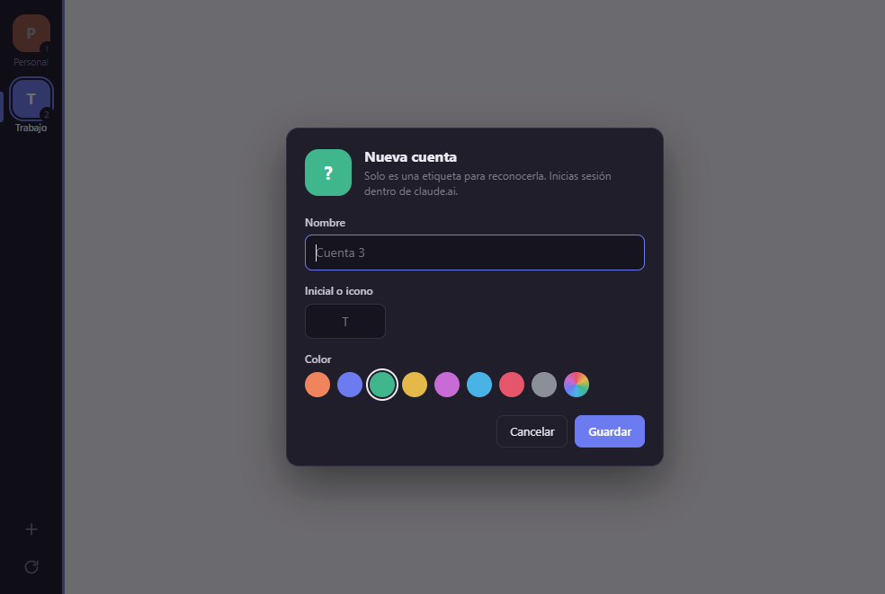

# Claude Dual

Aplicación de escritorio (Electron) para tener **dos o más cuentas de [claude.ai](https://claude.ai) abiertas a la vez**, cada una con su sesión aislada, y cambiar entre ellas con un clic o un atajo de teclado.

> [!IMPORTANT]
> **Proyecto no oficial.** Claude Dual no está afiliado, respaldado ni patrocinado por Anthropic. «Claude» y «Anthropic» son marcas de sus respectivos propietarios. La app solo muestra la web pública de claude.ai dentro de una ventana; no usa ninguna API privada.



## Qué hace

- **Una barra lateral estrecha** con un botón por cuenta: color, inicial (o emoji) y nombre siempre visibles. Una franja del color de la cuenta activa separa la barra del contenido y el título de la ventana muestra su nombre, para no equivocarte de cuenta.
- **Sesiones aisladas**: cada cuenta se carga en su propio `WebContentsView` con una partición persistente (`persist:cuenta1`, `persist:cuenta2`, …). Cookies, almacenamiento y caché no se mezclan.
- **Las sesiones se mantienen** al cerrar y volver a abrir la app.
- **Sin contraseñas**: la app no guarda ni gestiona credenciales. Inicias sesión dentro de la propia web de claude.ai (correo, Google o Apple).
- **Enlaces externos** (todo lo que no sea claude.ai, anthropic.com o el login de Google/Apple) se abren en tu navegador predeterminado.
- **Icono en la bandeja del sistema**: mostrar la app, saltar a una cuenta o salir. Cerrar la ventana la deja en la bandeja.
- Menú contextual (clic derecho) en el texto: copiar, pegar, sugerencias del corrector, abrir enlaces en el navegador.

## Instalación

### Opción A: instalador

Descarga `Claude-Dual-Setup-x.y.z.exe` desde la página de [Releases](https://github.com/marcosmoralesperez22/claude-dual/releases) y ejecútalo.

El instalador no está firmado, así que Windows SmartScreen puede mostrar un aviso. Pulsa **Más información → Ejecutar de todas formas**.

### Opción B: desde el código

Necesitas [Node.js](https://nodejs.org) 20 o superior y git.

```bash
git clone https://github.com/marcosmoralesperez22/claude-dual.git
cd claude-dual
npm install
npm start
```

Si `npm start` dice que Electron no se instaló correctamente, descarga su binario a mano con `node node_modules/electron/install.js`.

## Uso

1. Al abrir la app por primera vez hay dos cuentas: **Personal** y **Trabajo**. Inicia sesión en cada una dentro de su vista, como en el navegador.
2. Cambia de cuenta con un clic en la barra lateral o con **Ctrl+1**, **Ctrl+2**, …
3. **Añadir cuenta**: botón **+** de la barra lateral. Elige nombre, inicial (o un emoji) y color.
4. **Editar, reordenar o eliminar**: clic derecho sobre la cuenta (o doble clic para editar). Al eliminar una cuenta se borran sus cookies y datos locales en Claude Dual. Tu cuenta de claude.ai no se ve afectada.

### Inicio de sesión por correo

Si eliges «Continuar con correo electrónico», el enlace del email se abrirá en tu navegador normal, no en la app. Para usarlo en Claude Dual:

1. En el correo, haz clic derecho sobre el enlace y elige **Copiar enlace**.
2. En Claude Dual, haz clic derecho sobre la cuenta y elige **Abrir enlace del portapapeles en esta cuenta**.

Iniciar sesión con Google o Apple funciona directamente dentro de la app.

## Atajos de teclado

| Atajo | Acción |
| --- | --- |
| `Ctrl+1` … `Ctrl+9` | Cambiar a la cuenta 1…9 |
| `Ctrl+Tab` / `Ctrl+Shift+Tab` | Cuenta siguiente / anterior |
| `Ctrl+R` o `F5` | Recargar la cuenta activa |
| `Ctrl+Shift+R` | Recargar ignorando la caché |
| `Ctrl++` / `Ctrl+-` / `Ctrl+0` | Ampliar / reducir / restablecer el zoom |
| `Ctrl+Shift+I` | Herramientas de desarrollo de la cuenta activa |
| `Esc` | Cerrar el editor de cuenta |

En macOS usa `⌘` en lugar de `Ctrl`, salvo en `Ctrl+Tab`.

## Configuración

La configuración se guarda en `accounts.json`, dentro de la carpeta `userData` de Electron:

| Sistema | Ruta |
| --- | --- |
| Windows | `%APPDATA%\Claude Dual\accounts.json` |
| macOS | `~/Library/Application Support/Claude Dual/accounts.json` |
| Linux | `~/.config/Claude Dual/accounts.json` |

Solo contiene nombre, color e inicial de cada cuenta, la cuenta activa y la posición de la ventana. **Nunca contiene contraseñas.** Las cookies de cada cuenta las guarda Chromium en `Partitions/` dentro de esa misma carpeta.

Si tu organización usa un inicio de sesión único (SSO) con otro proveedor, añade su dominio en `extraAllowedHosts` (con la app cerrada) para que se abra dentro de la app:

```json
"extraAllowedHosts": ["miempresa.okta.com"]
```

## Compilar el instalador

```bash
npm install
npm run dist          # instalador del sistema actual
npm run dist:win      # Windows (.exe con NSIS)
npm run dist:mac      # macOS (.dmg); hay que compilarlo en un Mac
npm run dist:linux    # Linux (AppImage y .deb)
```

El resultado queda en `dist/`.

### Compilación automática con GitHub Actions

El workflow [`.github/workflows/release.yml`](.github/workflows/release.yml) compila el instalador de Windows y lo publica en una Release cada vez que subes un tag que empieza por `v`:

```bash
git tag v1.0.0
git push origin v1.0.0
```

## Seguridad

- `contextIsolation: true`, `nodeIntegration: false` y `sandbox: true` en todas las vistas.
- La barra lateral solo se comunica con el proceso principal mediante una API mínima expuesta con `contextBridge` (`preload.js`). El proceso principal ignora los mensajes que no vienen de la barra.
- Política de seguridad de contenido (CSP) estricta en la interfaz local.
- Los permisos web (micrófono, notificaciones, portapapeles) solo se conceden a claude.ai.
- El User-Agent se presenta como Chrome estándar, sin la marca «Electron». Solo en las páginas de inicio de sesión de Google se presenta como Firefox (sin las cabeceras `Sec-CH-UA`), porque Google bloquea los navegadores integrados basados en Chromium.

## Estructura

```
main.js          Proceso principal: ventana, vistas por cuenta, atajos, bandeja, IPC
preload.js       Puente seguro (contextBridge) entre la barra lateral y main.js
src/             Interfaz de la barra lateral (HTML/CSS/JS sin frameworks)
assets/          Iconos de la app y de la bandeja
scripts/         make-icons.js: genera los iconos sin dependencias (npm run icons)
```

## Licencia

[MIT](LICENSE) © 2026 Marcos Morales
